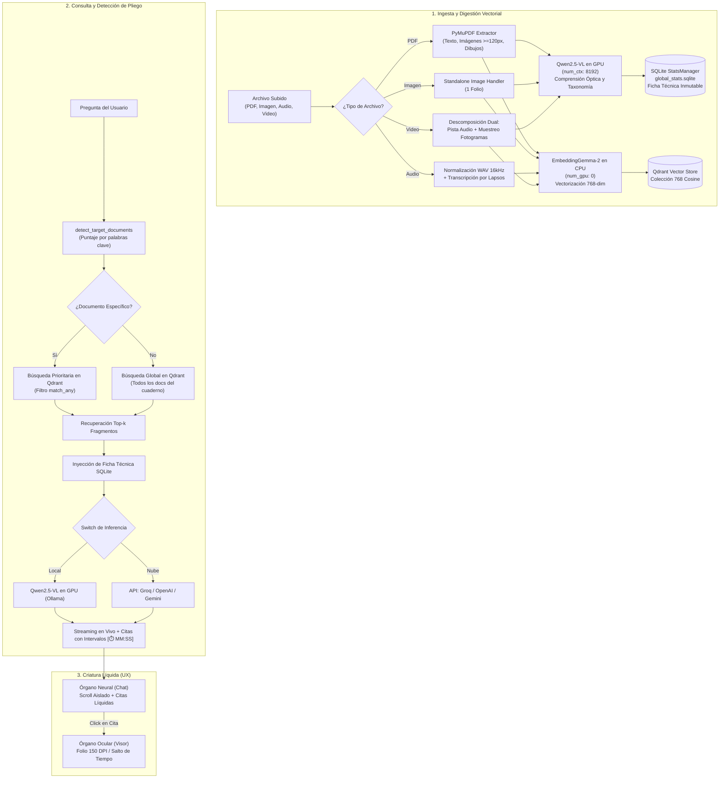

# Criatura Líquida — RAG Multimodal (Video, Audio, PDF, Imagen)
> **Sistema integral de Retrieval-Augmented Generation (RAG) Multimodal Local de alto rendimiento con identidad visual de Criatura Líquida de laboratorio y arquitectura de hardware estrictamente optimizada.**

---

## 📖 ÍNDICE DE CONTENIDOS
1. [Visión General y Sistema de Diseño: Criatura Líquida](#1-visión-general-y-sistema-de-diseño-criatura-líquida)
2. [Reglas Inviolables de Hardware y Entorno](#2-reglas-inviolables-de-hardware-y-entorno)
3. [Arquitectura del Sistema y Diagrama de Flujo](#3-arquitectura-del-sistema-y-diagrama-de-flujo)
4. [Estructura del Proyecto y Mapa de Módulos Limpio](#4-estructura-del-proyecto-y-mapa-de-módulos-limpio)
5. [Detalle Técnico de los Componentes Clave](#5-detalle-técnico-de-los-componentes-clave)
   - [Motor de Ingesta Multimodal (Video, Audio, PDF, Imagen)](#51-motor-de-ingesta-multimodal)
   - [Ficha Técnica Inmutable en SQLite](#52-ficha-técnica-inmutable-en-sqlite)
   - [Comprensión Visual con Qwen2.5-VL en GPU](#53-comprensión-visual-con-qwen25-vl-en-gpu)
   - [Vectorización Segura con EmbeddingGemma-2 en CPU](#54-vectorización-segura-con-embeddinggemma-2-en-cpu)
   - [Visor de Especímenes y Citas Precisas (Lapsos de Tiempo y Folios)](#55-visor-de-especímenes-y-citas-precisas)
   - [Conmutador Local (Ollama) vs. Nube (Groq, OpenAI, Gemini)](#56-conmutador-local-vs-nube)
6. [Instalación, Ejecución y Verificación](#6-instalación-ejecución-y-verificación)
7. [Mandamientos para IAs y Desarrolladores Futuros](#7-mandamientos-para-ias-y-desarrolladores-futuros)

---

## 1. VISIÓN GENERAL Y SISTEMA DE DISEÑO: CRIATURA LÍQUIDA

El proyecto traduce la arquitectura técnica de un sistema **RAG Multimodal Local** a la experiencia estética de una **Criatura Líquida de Laboratorio**: mitad metal fundido, mitad medusa marina. Todo tiene masa, inercia y viscosidad:

* **Mapa de Criatura (Órganos Flotantes):** El contenido se estructura en órganos biológicos interactivos:
  - **Órgano Neural (Chat):** Asistente encarnado por `qwen2.5vl:7b` en GPU, guiado por la Ficha Técnica Global en SQLite y los vectores recuperados de Qdrant.
  - **Órgano Ocular (Visor):** Proyección visual de folios PDF a 150 DPI, reproducción de video con fotogramas clave y segmentos de audio con saltos a marcas temporales `[⏱️ MM:SS]`.
  - **Vientre Ingestor (Sidebar):** Absorbe PDFs, imágenes, grabaciones de audio y videos desintegrándolos vectorialmente.
  - **Órgano Sináptico (Telemetría):** Monitoreo en tiempo real de latencias, impulsos y flujo del pipeline.
* **Navegación Líquida:** Orbe biomórfico flotante que sigue al cursor con inercia y se divide en constelación de burbujas.
* **Zona Tranquila (Quiet Zone):** Los controles funcionales (inputs, botones, selectores) mantienen máxima claridad y ergonomía.

### Paleta Estricta (4 Colores Sagrados)
- **Abisal: `#061A20`** (Fondo base submarino, azul-verde casi negro. Nunca negro puro).
- **Mercurio: `#CFD8DA`** (Texto y cromo líquido. Nunca blanco puro).
- **Naranja venenoso: `#FF5B14`** (Acento principal, presencia fuerte y enérgica).
- **Lima ácida: `#C6FF3D`** (Acento de apoyo, destellos bioluminiscentes y estados activos).
- *Cromo líquido:* Mercurio con reflejos abisales y resplandor perimetral de naranja o lima.

### Tipografía Dual
- **Bricolage Grotesque (variable):** Titulares elásticos y cuerpo. Reacciona a la velocidad y proximidad del cursor.
- **Instrument Serif en cursiva:** Susurros, anotaciones secundarias y reflexiones del organismo.
- Escala completamente irregular con titulares gigantes recortados contra los bordes de la pantalla y textos en curvas SVG `textPath`.

---

## 2. REGLAS INVIOLABLES DE HARDWARE Y ENTORNO

> [!CAUTION]
> **ATENCIÓN DESARROLLADORES Y AGENTES:**
> Este sistema está afinado con precisión para un hardware objetivo específico: **NVIDIA GeForce RTX 5050 (8GB VRAM) + Intel Core i7-13650HX + 32GB RAM**.

1. **Aislamiento Total en `.venv`:** Ejecutar exclusivamente con el Python local (`.\.venv\Scripts\python.exe`).
2. **Separación de Modelos en GPU vs. CPU:**
   - **Modelo Visual y de Chat:** `qwen2.5vl:7b` corre **ESTRICTAMENTE EN GPU** con `options={"num_ctx": 8192}`.
   - **Modelo de Embeddings:** `embeddinggemma-2:latest` corre **ESTRICTAMENTE EN CPU/RAM** con `options={"num_gpu": 0}` para proteger los 8GB de VRAM contra desalojos y OOM.
3. **Presupuesto de Contexto de Visión:** Las imágenes adjuntadas en el chat se optimizan a un máximo de 512px (~300 tokens de contexto) mediante `optimize_chat_image()`.
4. **Base de Datos Vectorial Local:** Qdrant en contenedor Docker en el puerto `6333` con persistencia en `./qdrant_storage`.

---

## 3. ARQUITECTURA DEL SISTEMA Y DIAGRAMA DE FLUJO



---

## 4. ESTRUCTURA DEL PROYECTO Y MAPA DE MÓDULOS LIMPIO

```
chatcasero/
├── app.py                      # Orquestador principal de la Criatura Líquida
├── docker-compose.yml          # Contenedor Qdrant (puerto 6333, ./qdrant_storage)
├── run.bat                     # Lanzador en 1 clic para Windows con comprobaciones
├── requirements.txt            # Dependencias limpias del entorno .venv
├── README.md                   # Documentación técnica completa
├── .gitignore                  # Exclusiones canónicas de Git
├── .dockerignore               # Exclusiones de Docker
│
├── core/                       # Núcleo RAG Multimodal
│   ├── config.py               # Hardware constraints, puertos y rutas
│   ├── liquid_theme.py         # Motor visual y animaciones de la Criatura Líquida
│   ├── cloud_llm.py            # Conector de inferencia en la nube (Groq, OpenAI, Gemini)
│   ├── document_viewer.py      # Renderizado de folios a 150 DPI y resaltes venenosos
│   ├── notebook_manager.py     # Gestor de cuadernos (persistencia notebooks.json)
│   ├── pdf_extractor.py        # PyMuPDF: texto, imágenes y dibujos vectoriales
│   ├── audio_processor.py      # Normalización WAV y transcripción fonética
│   ├── video_processor.py      # Muestreo de fotogramas y comprensión visual
│   ├── rag_engine.py           # Orquestador RAG multimodal, detección y streaming
│   ├── stats_manager.py        # SQLite: ficha técnica y conteo matemático exacto
│   ├── vector_store.py         # Cliente Qdrant y embeddings Gemma-2 en CPU
│   ├── visual_analyzer.py      # Cliente Qwen2.5-VL para comprensión visual
│   ├── media_types.py          # Detección de formatos y formateo de timestamps
│   └── traceability.py         # Registro de telemetría y ciclo de vida de trazas
│
├── ui/                         # Órganos Visuales de la Interfaz
│   ├── header.py               # Órgano cefálico, tipografía gigante recortada y cromo vivo
│   ├── chat.py                 # Órgano neural de diálogo y streaming
│   ├── viewer.py               # Órgano ocular: visor de folios, audio y video
│   ├── sidebar.py              # Vientre ingestor: carga de archivos y conmutador LLM
│   ├── traceability_view.py    # Órgano sináptico: telemetría y diagramas
│   └── state.py                # Estado de sesión y control de visor
│
└── data/                       # Persistencia local
    ├── uploads/                # Archivos físicos subidos
    ├── extracted_images/       # Figuras y recortes de alta resolución
    ├── global_stats.sqlite     # Base de datos relacional de ficha técnica
    └── notebooks.json          # Historial de conversaciones por cuaderno
```

---

## 5. DETALLE TÉCNICO DE LOS COMPONENTES CLAVE

### 5.1. Motor de Ingesta Multimodal
* Extrae texto, gráficos vectoriales y figuras raster de PDFs.
* Soporta videos (`.mp4`, `.mkv`, `.avi`, `.mov`, `.webm`) con extracción automática de pista de audio y muestreo de fotogramas representativos.
* Soporta audios (`.mp3`, `.wav`, `.m4a`, `.flac`) con transcripción temporal por intervalos.

### 5.2. Ficha Técnica Inmutable en SQLite
* SQLite computa con exactitud matemática el conteo de elementos visuales (gráficos estadísticos, diagramas, tablas y fotos) y la duración total de audios/videos.
* Se inyecta en el prompt inicial del sistema para evitar alucinaciones estadísticas.

### 5.3. Comprensión Visual con Qwen2.5-VL en GPU
* Clasifica formalmente cada gráfico, transcribe ejes, datos numéricos y notas visibles en GPU dedicada.

### 5.4. Vectorización Segura con EmbeddingGemma-2 en CPU
* Embeddings de 768 dimensiones forzados estrictamente a CPU (`options={'num_gpu': 0}`) para preservar la VRAM de la RTX 5050.

### 5.5. Visor de Especímenes y Citas Precisas
* **Folios PDF:** Proyección nítida a 150 DPI con resaltes fluorescentes en Naranja Venenoso `#FF5B14` y Lima Ácida `#C6FF3D`.
* **Audio y Video:** Citas con intervalo temporal exacto `[⏱️ MM:SS - MM:SS]` que sincronizan el reproductor multimedia.

### 5.6. Conmutador Local vs. Nube
* Conmutación instantánea entre el modelo local de 8k context y proveedores cloud como Groq, OpenAI o Gemini.
* Las API keys residen exclusivamente en memoria volátil de la sesión.

---

## 6. INSTALACIÓN, EJECUCIÓN Y VERIFICACIÓN

### Puesta en Marcha en 1 Clic (Windows)
Simplemente ejecuta:
```cmd
run.bat
```
El script verificará el entorno virtual, iniciará el contenedor Qdrant en Docker y abrirá la Criatura Líquida en `http://localhost:8501`.

### Verificación de Tests Unitarios
Para ejecutar la suite de pruebas del sistema:
```powershell
.\.venv\Scripts\python.exe -m unittest discover -s tests
```

---

## 7. MANDAMIENTOS PARA IAS Y DESARROLLADORES FUTUROS

1. **PALETA ESTRICTA DE LA CRIATURA LÍQUIDA:** Mantén exclusivamente la jerarquía de 4 colores: Abisal `#061A20`, Mercurio `#CFD8DA`, Naranja Venenoso `#FF5B14` y Lima Ácida `#C6FF3D`.
2. **TIPOGRAFÍA:** Usa `Bricolage Grotesque` para estructura elástica y titulares, e `Instrument Serif` en cursiva para anotaciones y susurros.
3. **NO DESALOJAR LA GPU:** Forzar siempre `options={'num_gpu': 0}` en embeddings. Nunca quitar esta restricción.
4. **8K TOKENS EN CHAT:** Mantener `options={'num_ctx': 8192}` para `qwen2.5vl:7b`.
5. **DOBLE SCROLL AISLADO:** La ventana principal nunca debe scrollear verticalmente; el chat y el visor poseen sus propios contenedores con altura acotada.
